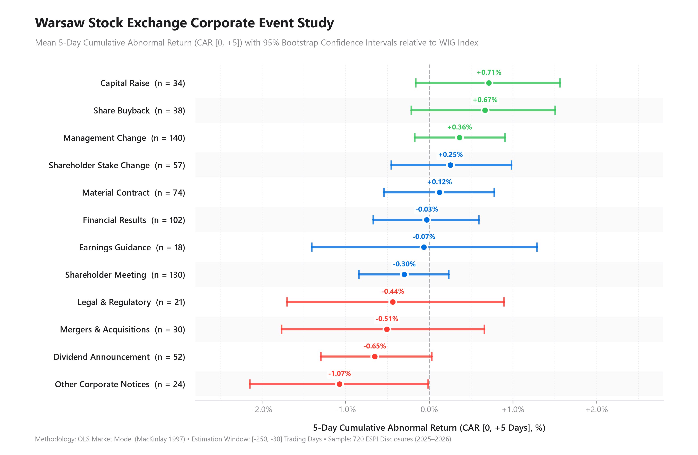

# espi-event-analysis

Quantitative event study measuring the share-price impact of Warsaw Stock Exchange (GPW) corporate disclosures extracted with LLMs.



## Overview

Publicly traded Polish companies disclose market-moving inside information through ESPI (*Elektroniczny System Przekazywania Informacji*) regulatory notices. 

**espi-event-analysis** extracts structured events from free-text Polish disclosures and evaluates their empirical market impact using an econometric market model:
1. **Structured Extraction:** Disclosures are parsed into strict Pydantic schemas classifying announcements into 12 distinct event categories, capturing monetary figures, and verifying verbatim text evidence.
2. **Calendar Alignment:** Automatically accounts for trading session boundaries (announcements published at or after 17:00 CET roll forward to Day 0 of the next trading session).
3. **Econometric Event Study:** Computes Cumulative Abnormal Returns (CAR) using an OLS market model against the benchmark WIG index over estimation window `[-250, -30]` trading days, with 95% bootstrap confidence intervals.

---

## Key Empirical Findings

Analysis across **720 corporate announcements** from 30 major GPW issuers (2025–2026):

| Announcement Category | Sample ($n$) | Mean CAR [0, +1] (%) | 95% Bootstrap CI [0, +1] | Mean CAR [0, +5] (%) | 95% Bootstrap CI [0, +5] |
|:---|:---:|:---:|:---:|:---:|:---:|
| **Share Buyback** | 38 | **+0.615%** | [+0.025, +1.184] | **+0.666%** | [-0.215, +1.505] |
| **Capital Raise** | 34 | +0.197% | [-0.309, +0.722] | +0.712% | [-0.162, +1.563] |
| **Management Change** | 140 | -0.083% | [-0.370, +0.207] | +0.361% | [-0.173, +0.905] |
| **Material Contract** | 74 | +0.361% | [-0.038, +0.741] | +0.121% | [-0.542, +0.776] |
| **Shareholder Stake Change** | 57 | -0.272% | [-0.728, +0.191] | +0.252% | [-0.454, +0.983] |
| **Financial Results** | 102 | +0.102% | [-0.213, +0.400] | -0.030% | [-0.669, +0.594] |
| **Earnings Guidance** | 18 | -0.151% | [-0.773, +0.450] | -0.065% | [-1.405, +1.288] |
| **Shareholder Meeting** | 130 | +0.224% | [-0.083, +0.536] | -0.299% | [-0.840, +0.234] |
| **Legal & Regulatory** | 21 | -0.350% | [-0.915, +0.266] | -0.437% | [-1.700, +0.894] |
| **Mergers & Acquisitions** | 30 | +0.015% | [-0.561, +0.630] | -0.507% | [-1.764, +0.660] |
| **Dividend Announcement** | 52 | -0.141% | [-0.571, +0.318] | -0.653% | [-1.295, +0.029] |
| **Other Corporate Notices** | 24 | -0.528% | [-1.325, +0.276] | -1.073% | [-2.145, -0.014] |

* **Share Buybacks** demonstrate statistically significant immediate positive excess returns of **+0.615%** ($t = 2.06$) over $[0, +1]$ trading days.
* **Routine Notices** (e.g., Board Appointments, General Meetings) exhibit returns indistinguishable from zero market noise.

---

## Quickstart

```bash
# 1. Setup virtual environment
python -m venv .venv
source .venv/bin/activate       # On Windows: .venv\Scripts\activate

# 2. Install dependencies
pip install -r requirements.txt

# 3. Run event analysis and render chart
python run.py

# Optional: Run with de-clustering filter (events separated by > 5 trading days)
python run.py --no-overlap

# 4. Run test suite
pytest -q
```

---

## Repository Structure

```
espi-event-analysis/
├── data/
│   ├── events.parquet        # Extracted events mapped to tickers and dates
│   ├── reports.parquet       # Raw disclosure bodies
│   └── prices/               # Daily price series from Stooq
├── espi/
│   ├── config.py             # Global path and model settings
│   ├── schema.py             # Pydantic schemas and event definitions
│   ├── extract.py            # Structured LLM extraction logic
│   ├── prices.py             # Calendar alignment and return calculation
│   ├── event_study.py        # OLS market model & Apple-style visualization
│   └── pipeline.py           # Unified execution coordinator
├── results/
│   ├── event_study_car.png   # High-resolution publication chart
│   ├── event_study_summary.csv # Statistical summary table
│   └── event_study_per_event.csv
├── tests/                    # Unit tests for prices, schema, and market model
├── run.py                    # CLI entrypoint
├── requirements.txt
└── README.md
```

---

## Methodology

* **Model:** Classical Market Model ($R_{it} = \alpha_i + \beta_i R_{mt} + \varepsilon_{it}$, MacKinlay 1997).
* **Estimation Window:** $T \in [-250, -30]$ trading days relative to announcement Day 0.
* **Inference:** 5,000-sample non-parametric bootstrap 95% confidence intervals.
* **Benchmark:** WIG (Warsaw Stock Exchange Broad Index).

## License

MIT
